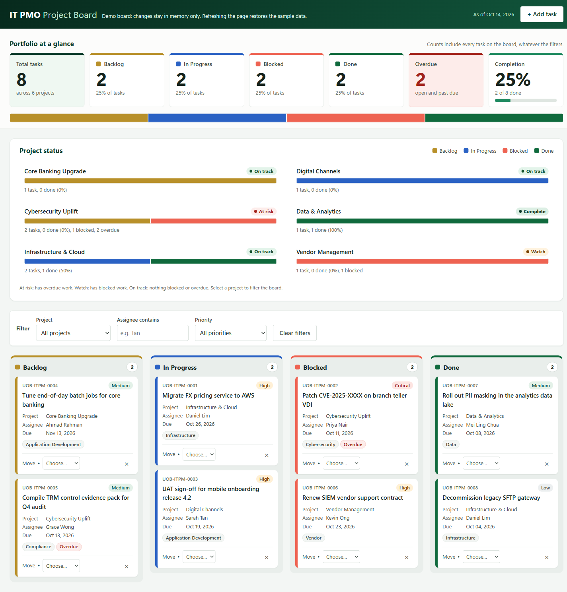

# kanban6 v2

A single-file IT PMO Kanban board for demos and training, built with plain HTML, CSS and JavaScript.

**Live demo:** https://alfredang.github.io/kanban6-v2/

## Features

- Four columns: Backlog, In Progress, Blocked and Done. Move cards by drag and drop or with the keyboard-friendly "Move ▸" control.
- Large KPI tiles (total, each status, overdue, completion %) above a status ribbon that shows the whole portfolio at a glance.
- Colour-coded statuses, used the same way on the KPIs, charts, columns and cards. The palette has been checked for colour-vision deficiency, and text labels always appear alongside the colours.
- A project status panel with a stacked status bar and a health label (At risk / Watch / On track / Complete) for each project. Select a project to filter the board.
- An Add Task form with inline validation, plus filters and overdue badges.
- Inline "Delete? Yes / No" confirmation on cards.

## Security hardening

- Content Security Policy with SHA-256 hashes for the inline style and script. Network access is limited to FormSubmit. Forms, base URLs and plugins are blocked, and no referrer is sent.
- Every free-text input is sanitised: control and bidi-override characters are stripped and lengths are capped. All output is HTML-escaped.
- Validation of assignee names, real calendar dates and due-date range. Drops are accepted only for the board's own task IDs.
- Email notifications are skipped until a real address is configured. They're also throttled (one every 10 s, 20 per session) and sent without credentials or redirects.

After editing the `<style>` or `<script>` block, run `node tools/csp-hash.js` to update the CSP hashes.

## Run it

Open `index.html` in a browser (double-clicking it works). There's no build step and no server.

Tasks live only in memory, on purpose. Refreshing the page resets the board to the demo data.

## Email notifications

New tasks send an email notification through [FormSubmit](https://formsubmit.co). To choose the recipient, set the address in `FORMSUBMIT_ENDPOINT` at the top of the script in `index.html`. FormSubmit sends a one-time activation email on the first submission, and nothing is delivered until the link in it is clicked. If the notification fails, the task is still added and a warning toast is shown. While the placeholder address is still in place, no request is sent.

## Tech

Vanilla HTML, CSS and JavaScript in a single file. No frameworks, libraries or other dependencies.

## Deployment

Every push to `main` deploys `index.html` to GitHub Pages through [`.github/workflows/pages.yml`](.github/workflows/pages.yml).

## Disclaimer

This is a fictitious demo. It isn't affiliated with, endorsed by or connected to any real bank.
